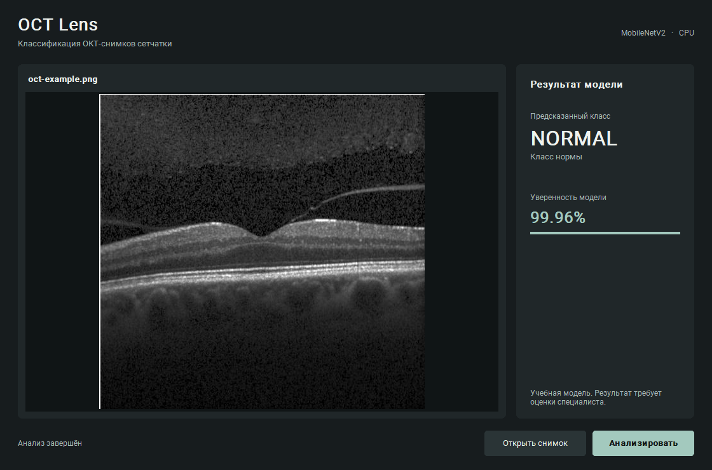

<div align="center">
  <h1>OCT Lens</h1>
  <p><strong>ОКТ-снимок сетчатки и результат модели в одном окне.</strong></p>
  <p>Локальное приложение для классификации снимков с помощью MobileNetV2.</p>
  
  <p><a href="#start">Запуск</a> · <a href="#model">Модель и результаты</a> · <a href="#development">Разработка</a></p>
</div>



<p align="center"><sub>Пример из локальной тестовой выборки. Справа показаны предсказанный класс и значение softmax для него.</sub></p>

## Работа со снимком

1. Нажмите **Открыть снимок** и выберите JPEG, PNG, BMP или TIFF.
2. Нажмите **Анализировать**. Вычисления выполняются в фоне.
3. Посмотрите предсказанный класс, его описание и уверенность модели рядом с исходным изображением.

Модель загружается при запуске. При выборе следующего изображения предыдущий результат сбрасывается. Пропорции снимка сохраняются при изменении размера окна.

> [!NOTE]
> Это учебный проект классификации изображений. Значение softmax показывает оценку выбранного класса моделью. Для медицинской интерпретации снимка нужна оценка специалиста.

<a id="start"></a>

## Запуск в Windows

Установите Python 3.13 x64. Скачайте репозиторий через **Code → Download ZIP** и распакуйте архив. Запустите **setup_env.bat**, дождитесь установки зависимостей, затем откройте **run.bat**.

Для установки нужен интернет. Обработка снимков выполняется на компьютере. Обученные веса `best_model.pth` включены в репозиторий.

Альтернативный запуск из PowerShell в папке проекта.

```powershell
py -3.13 -m venv .venv
.\.venv\Scripts\python.exe -m pip install -r requirements.txt
.\.venv\Scripts\python.exe app.py
```

<a id="model"></a>

## Модель и результаты

Используется MobileNetV2 с классификатором на четыре класса. Перед анализом изображение переводится в RGB, приводится к размеру 224 × 224 и нормализуется параметрами ImageNet. Приложение выбирает CUDA при доступном совместимом окружении, иначе использует CPU.

| Класс | Обозначение в наборе |
| --- | --- |
| CNV | Хориоидальная неоваскуляризация |
| DME | Диабетический макулярный отёк |
| DRUSEN | Друзы |
| NORMAL | Класс нормы |

При подготовке проекта веса повторно проверены на локальной выборке `OCT2017_/test`.

| Показатель | Результат |
| --- | ---: |
| Снимков | 968 |
| Снимков на класс | 242 |
| Accuracy | 98,14% |
| Macro-F1 | 0,9813 |

Эти показатели относятся к указанной выборке. В [отчёте проверки](docs/evaluation.json) сохранены матрица ошибок, версия PyTorch и контрольная сумма весов. [История обучения](training_history.json) содержит показатели по 15 эпохам.

<a id="development"></a>

## Разработка

| Файл | Назначение |
| --- | --- |
| `app.py` | Интерфейс, загрузка модели, подготовка снимка и предсказание |
| `best_model.pth` | Обученные веса |
| `train.py` | Дообучение MobileNetV2 и сохранение лучшей модели по macro-F1 |
| `evaluate.py` | Оценка тестовой выборки и построение графиков |
| `tests/test_app.py` | Проверки загрузки весов, обработки снимков и ошибок интерфейса |

Проверка приложения выполняется на обученных весах и синтетических изображениях, созданных тестами. Во время проверки открывается окно интерфейса.

```powershell
.\.venv\Scripts\python.exe -m unittest discover -s tests -v
```

### Обучение и оценка

Для экспериментов установите дополнительные зависимости и подготовьте локальную копию OCT2017. Скрипты ожидают папки `OCT2017_/train` и `OCT2017_/test` с подпапками `CNV`, `DME`, `DRUSEN` и `NORMAL`. Валидационная выборка формируется из `train` по 500 изображений на класс.

```powershell
.\.venv\Scripts\python.exe -m pip install -r requirements-training.txt
.\.venv\Scripts\python.exe train.py
.\.venv\Scripts\python.exe evaluate.py
```

Обучение записывает веса в `best_model.pth` и историю в `training_history.json`. Первый запуск обучения загружает исходные веса ImageNet. Графики оценки сохраняются в `evaluation_results/`.

### Сборка Windows-приложения

`build_exe.bat` собирает приложение через PyInstaller в `dist/OCTLens/` и копирует туда обученные веса. Для переноса нужна вся папка сборки.
